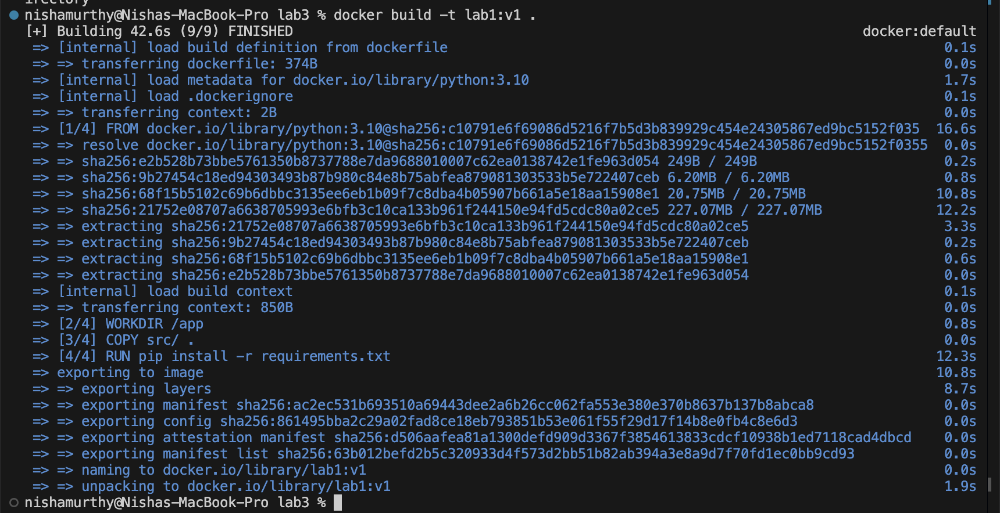
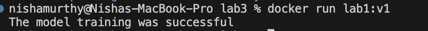
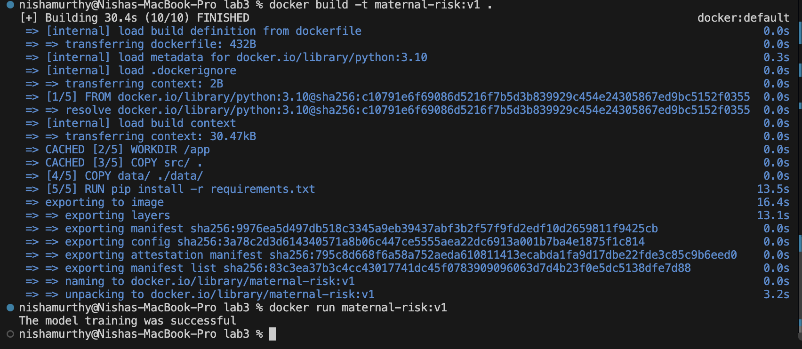
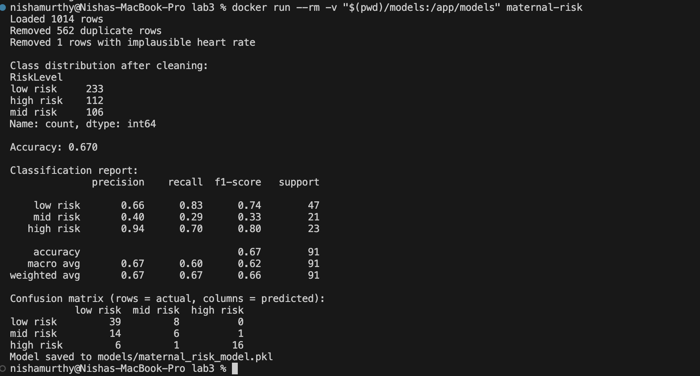
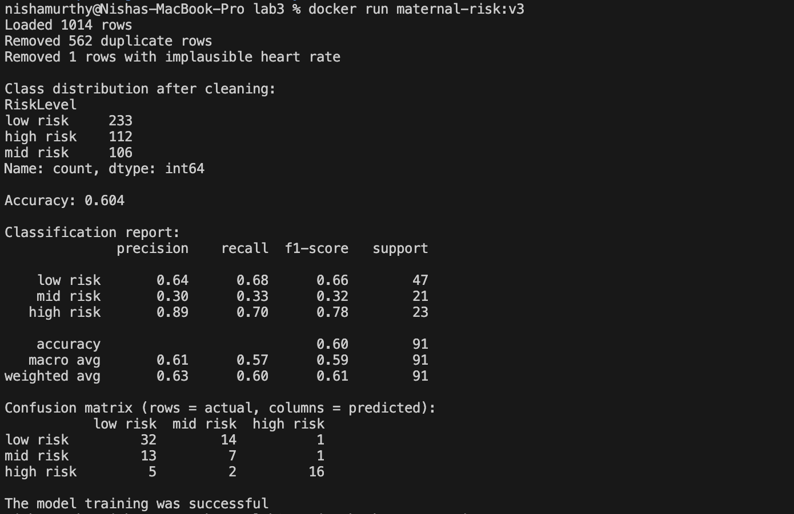
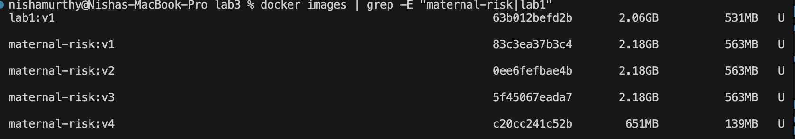
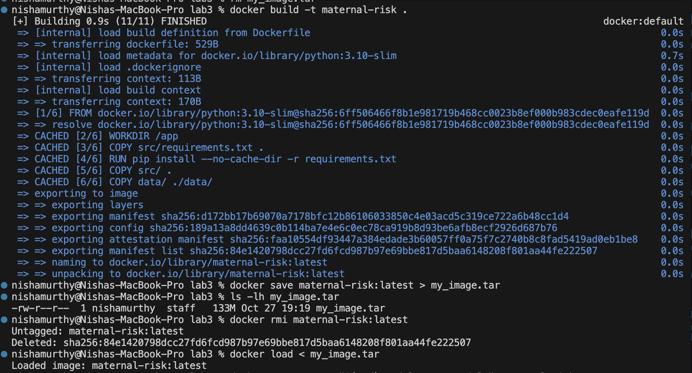

# Maternal Health Risk Classifier: Docker Lab

A Dockerized training pipeline that predicts a pregnant woman's health risk level (**low risk**, **mid risk**, or **high risk**) from 6 health measurements, using a Gradient Boosting model.

This project is based on the Docker Lab (Lab1) from the course. I first ran the original Iris version, then rebuilt it with a new dataset, data cleaning, a different model, evaluation, and an improved Docker setup.

---

## Changes from the original lab

| Area | Original lab | This version |
|---|---|---|
| Dataset | Iris (built into scikit-learn) | Maternal Health Risk (UCI), loaded from a CSV in `data/` |
| Data cleaning | None | Duplicate rows and implausible heart rates removed |
| Train/test split | Random 80/20 | Stratified 80/20 |
| Model | Random Forest | Gradient Boosting |
| Evaluation | None | Accuracy, per-class report, and confusion matrix printed after training |
| Base image | `python:3.10` | `python:3.10-slim` |
| Build caching | Code and dependencies copied together | `requirements.txt` installed first, so code changes don't reinstall packages |
| Trained model | Saved inside the container and lost when it exits | Saved to the local `models/` folder via a volume mount |

**Why commit the CSV instead of downloading it?** The dataset could be fetched at runtime with the `ucimlrepo` package, but then the container would need internet access on every run and would depend on the UCI site being available. Copying the CSV into the image keeps it fully self-contained and reproducible.

---

## Dataset

The [Maternal Health Risk dataset](https://archive.ics.uci.edu/dataset/863/maternal+health+risk) from the UCI Machine Learning Repository (Ahmed, 2020) contains health records of pregnant women collected from hospitals, community clinics, and maternal health care centres in rural Bangladesh through an IoT-based risk monitoring system.

| Feature | Description |
|---|---|
| `Age` | Age in years during pregnancy |
| `SystolicBP` | Upper value of blood pressure (mmHg) |
| `DiastolicBP` | Lower value of blood pressure (mmHg) |
| `BS` | Blood sugar level (mmol/L) |
| `BodyTemp` | Body temperature (°F) |
| `HeartRate` | Resting heart rate (bpm) |
| `RiskLevel` | Target: low risk, mid risk, or high risk |

---

## Project structure

```
MLOPS-Lab3/
├── data/
│   └── maternal_health_risk.csv   # Maternal Health Risk dataset
├── models/                        # Trained model (created by the volume mount, not committed)
├── screenshots/                   # Screenshots
├── src/
│   ├── main.py                    # Loads, cleans, trains, evaluates, and saves the model
│   └── requirements.txt           # Pinned dependencies
├── .dockerignore
├── .gitignore
├── Dockerfile
└── README.md
```

---

## Setup

Requires Docker Desktop, installed and running.

---

## Running the lab

All commands are run from the repo root.

**1. Build the image**

```bash
docker build -t maternal-risk .
```

**2. Run the container with a volume mount**

```bash
docker run --rm -v "$(pwd)/models:/app/models" maternal-risk
```

**3. Check that the model was saved**

```bash
ls models/
```

The `-v` flag links the local `models/` folder to `/app/models` inside the container, so the trained model is kept after the container exits. `--rm` removes the stopped container afterwards.

**4. Save the image as a file and load it back**

```bash
docker save maternal-risk > my_image.tar
docker rmi maternal-risk
docker load < my_image.tar
docker run --rm -v "$(pwd)/models:/app/models" maternal-risk
```

`docker save` exports the whole image, including Python, the packages, the code, and the dataset, into a single `.tar` file that can be copied to another machine and loaded with `docker load`, no internet or rebuild needed. Here the image is deleted and restored from the file to show that it works. The `.tar` file is excluded by `.gitignore`.

---

## Docker improvements

**Slim base image.** `python:3.10-slim` contains only what is needed to run Python, so the image is much smaller than the original.

| Image | Disk usage | Content size |
|---|---|---|
| Original (`python:3.10`) | 2.06 GB | 531 MB |
| This version (`python:3.10-slim`) | 651 MB | 139 MB |

The image is about 68% smaller on disk, and the exported `.tar` file is 133 MB.

**Build caching.** `requirements.txt` is copied and installed before the rest of the code. Docker caches that step, so editing `main.py` and rebuilding takes seconds instead of reinstalling every package.

**Pinned dependencies.** Every package version is fixed, including numpy and scipy, which scikit-learn depends on. The image is built with exactly the same packages every time.

**Ignore files.** `.dockerignore` keeps files like `.git`, screenshots, and model files out of the build, and `.gitignore` keeps generated files like `.pkl` and `.tar` out of the repo.

---

## Results

### Data cleaning

562 of the 1,014 rows were exact duplicates, more than half of the dataset. One row had a heart rate of 7 bpm, which is not physiologically possible. After cleaning, **451 unique records** remained: 233 low risk, 112 high risk, and 106 mid risk.

**Why remove duplicates?** Without this step, many test rows would have identical copies in the training set, and the model would score higher by memorizing them instead of generalizing.

### Model performance

On a stratified 80/20 split, the model reaches **67.0% test accuracy** (61 of 91 records correct).

| Risk level | Precision | Recall | F1 |
|---|---|---|---|
| Low risk | 0.66 | 0.83 | 0.74 |
| Mid risk | 0.40 | 0.29 | 0.33 |
| High risk | 0.94 | 0.70 | 0.80 |

**Confusion matrix** (rows = actual, columns = predicted)

| | Low risk | Mid risk | High risk |
|---|---|---|---|
| **Low risk** | 39 | 8 | 0 |
| **Mid risk** | 14 | 6 | 1 |
| **High risk** | 6 | 1 | 16 |

Low risk is predicted well, and high risk has very high precision, when the model predicts high risk, it is almost always right. Mid risk is the hardest class, with 14 of 21 cases predicted as low risk. This fits the data, mid risk sits between the other two levels and overlaps heavily with low risk on these six features.

The most serious error is the 6 high-risk cases predicted as low risk. In a healthcare setting, missing a high-risk pregnancy is far more costly than a false alarm, so recall for the higher-risk classes matters more than overall accuracy.

### Experiment: balanced sample weights

To test whether class imbalance caused the weak mid-risk results, I retrained the model with balanced sample weights, which make the smaller mid and high-risk classes count more during training.

| Metric | Unweighted | Balanced weights |
|---|---|---|
| Accuracy | 0.670 | 0.604 |
| Low risk recall | 0.83 | 0.68 |
| Mid risk recall | 0.29 | 0.33 |
| High risk recall | 0.70 | 0.70 |

The weights gained only one correct mid-risk prediction, did not improve high-risk recall, and lowered low-risk recall sharply. They mostly moved errors between classes rather than reducing them, which shows the problem is limited separation between mid and low risk in the features, not class imbalance. I reverted the change, so the final model uses no weights.

---

## Screenshots

### Original lab (Iris)

| Build | Run |
|---|---|
|  |  |

### This version (Maternal Health Risk)

**CSV dataset copied into the image**



**Training output, with the model saved through the volume mount**



**Balanced weights experiment**



**Image size comparison**



**Saving the image to a file and loading it back**

